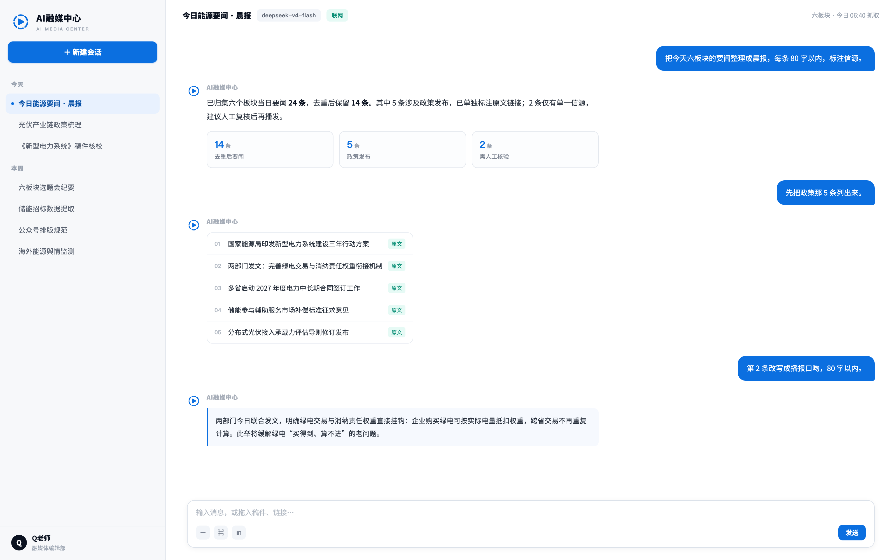

<p align="center"></p>

<p align="center"><strong>Topic, review, rewrite, compliance, layout — one chain for AI-assisted content production.</strong></p>
<p align="center">Built for media and content teams on DeepSeek Harness's open plugin system: personal use out of the box, company models and collaboration once the enterprise backend is connected.</p>
<p align="center"><a href="#download-desktop">Download Desktop</a> · <a href="#one-chain-from-topic-to-publish">Content chain</a> · <a href="#built-in-skills">Built-in skills</a> · <a href="#personal-and-enterprise">Personal and enterprise</a> · <a href="docs/user-guide.en.md">User guide</a> · <a href="README.zh-CN.md">简体中文</a></p>

[](https://github.com/quchenchen/epuber-dsh/releases/tag/desktop-v3.0.0-alpha.8) [](https://github.com/quchenchen/epuber-dsh) [](LICENSE)

[](https://github.com/quchenchen/epuber-dsh/actions/workflows/ci.yml)

## One screen for today's work

Sessions sit on the left under Today, This week, and Earlier. The right side holds the process and the result for the thing you are doing: which items were aggregated, which are policy releases, and which one rests on a single source and needs a human check — in the conversation instead of spread across ten browser tabs.



<sub>Interface design mockup. Sample sessions and figures are demonstration data and are not shipped with the installer.</sub>

## One chain: from topic to publish

Each step has a method and a checklist behind it, so the house rules do not have to be restated every time.

| Step | What happens | Built-in skill |
| --- | --- | --- |
| Topic | Track fixed channels, turn findings into evidenced topic entries, score them and schedule them into the story meeting and topic library | `topic-discovery` |
| Writing | Draft in a house style (CCTV, People's Daily, Xinhua) or an industry register (power, solar, storage, oil and gas, dual carbon) | `news-cctv` `news-renmin` `news-xinhua` `news-industry-energy` |
| Review | Two review rounds, the three-review/three-proofread routine, source grading, de-AI-flavour pass; facts and wording together | `news-desk` |
| Rewrite | One draft to many platforms: WeChat article, video script, Weibo flash, website — facts and conclusions unchanged, claims never escalated | `platform-rewrite` |
| Compliance | Walk every public face of the finished package: video frames and audio, images and covers, titles and tags, account surfaces; nine risk classes with a graded verdict | `publish-compliance` |
| Visuals | Composition plans for promotional images and posters, VI and standard-map checks, portrait ordering, AI-generated labelling | `visual-production` |
| Video | Storyboards for promos, news shorts and micro-documentaries, delivered as a shootable shot list | `video-script` |
| Delivery | Word, PPT, Excel and web layout, still editable in the preview panel | `word-design` `ppt-design` `excel-design` `web-design` |

Nothing is hard-coded to one newsroom: house style, industry discipline and approved reference material become project instructions and project material, and when two skills disagree the stricter one wins.

## Built-in skills

Sixteen skills ship with the installer, so there is no market search first:

| Group | Skills |
| --- | --- |
| Topics and sources | `topic-discovery`, `news-cctv`, `news-renmin`, `news-xinhua`, `news-industry-energy` |
| Editing and review | `news-desk`, `platform-rewrite`, `publish-compliance` |
| Visuals and video | `visual-production`, `video-script` |
| Layout and delivery | `word-design`, `ppt-design`, `excel-design`, `web-design` |
| Extending | `workbench-dev` (build your own workbench), `skill-creator` (write your own skills) |

A skill is instructions and resources around a `SKILL.md`, installable straight into the local skills directory. An expert stores a role and capability settings; a connector reaches external data. All three live in the same plugin system, and installing any of them stays your call.

## Projects, library and knowledge

- **Projects** hold instructions, plans, tasks, material and capability settings — a long-running beat, one story meeting, or a continuously updated industry briefing each become a project.
- **The library** manages local files, search and previews. Tasks reference material and its revision, so an edited file does not silently replace what a task saw.
- **Knowledge** keeps searchable entries and cites them when answering.
- **The deliverable workspace** previews or edits working copies of Word, PPT, Excel, HTML and PDF on the right, without an export round trip.

The path from material to deliverable: a library file is referenced by a project task, the task runs through an expert, a skill or a connector, and the process and result stay in the conversation for further edits in a supported editor. This path is still being validated during Alpha; preview, editing and export fidelity differ by format — see [current capabilities and limits](apps/web/README.md).

## Personal and enterprise

The same feature plugins, two ways to use them:

| Mode | Where the Agent and tools run | How to enter |
| --- | --- | --- |
| Personal Desktop | On your computer, with personal files and model settings | Open the app and choose personal use |
| Enterprise Desktop | On the employee's computer, with local files and tools | Install the desktop app and the Enterprise Connection plugin, then choose enterprise sign-in |

Enterprise features are enabled by the **Enterprise Connection plugin** on demand; the base installer does not preinstall it. It provides company sign-in, `@`-mentioning colleagues with shared text and files, sent and received records in Collaboration, and company model APIs in the model settings (real supplier keys stay in the admin backend). Independent business plugins can inject `epuberdshEnterprise` to call company APIs with the current member login, without reading or storing tokens.

The enterprise plugin is not listed in a plugin marketplace: [download the Enterprise Connection package](https://github.com/quchenchen/epuber-dsh/releases/download/desktop-v3.0.0-alpha.8/epuberdsh-enterprise-connection-0.1.0-alpha.2.tgz), enter the downloaded file's full path in Plugins → Add plugin, install and enable it, then enter the backend address and account under Settings → Enterprise account.

The enterprise backend is developed and deployed independently in **[techflag/workdsh-admin](https://github.com/techflag/workdsh-admin)**: company accounts, organization permissions, collaboration data, member-authorized conversation auditing and model forwarding all come from it. Desktop keeps personal and enterprise data and credentials in separate spaces; collaboration is installed on demand and stays inactive in personal mode.

## Download Desktop

Desktop **3.0.0-alpha.8** is published as a pre-release (Alpha). The [GitHub Release](https://github.com/quchenchen/epuber-dsh/releases/tag/desktop-v3.0.0-alpha.8) provides these complete installers:

| Platform | Download |
| --- | --- |
| Windows x64 | [Setup.exe installer](https://github.com/quchenchen/epuber-dsh/releases/download/desktop-v3.0.0-alpha.8/dsh-plugin-desktop-windows-x64--EpuberDSH-3.0.0-alpha.8-x64-Setup.exe) |
| macOS Apple Silicon | [arm64.dmg](https://github.com/quchenchen/epuber-dsh/releases/download/desktop-v3.0.0-alpha.8/dsh-plugin-desktop-macos-arm64--EpuberDSH-3.0.0-alpha.8-arm64.dmg) |
| macOS Intel | [x64.dmg](https://github.com/quchenchen/epuber-dsh/releases/download/desktop-v3.0.0-alpha.8/dsh-plugin-desktop-macos-x64--EpuberDSH-3.0.0-alpha.8-x64.dmg) |

Installers bundle Node.js, pnpm and Python, so no separate runtime is needed. **On Intel Macs the runtime is assembled from official components of this same DSH version**, because the publisher has not released an Intel build of it yet: the arch-independent payload (Office skills, pnpm, the `dsh` command manager) comes from the Apple Silicon build of `0.2.2-rc.1`, while the Intel executables (Node 24.21.0, Python 3.12.14 and the command linker that installs the `dsh` command) come from the newest official Intel build, which ships those exact versions. Both archives stay pinned by size and SHA-512, the assembled runtime is checked for foreign executables before packaging, and its provenance record names exactly which two builds it came from. This is an **Alpha release**: project document references, expert execution and end-to-end Office formatting are still being validated. macOS DMGs are unsigned; right-click → Open on first launch. Asset names carry the build platform prefix, and `SHA256SUMS` lets you verify each download.

**Development and feedback**: GitHub is the sole development source and release channel — report problems in [GitHub Issues](https://github.com/quchenchen/epuber-dsh/issues). Backend account, permission or model-forwarding issues go to [EpuberDSH Admin](https://github.com/techflag/workdsh-admin/issues). **Issues are public: do not upload passwords, tokens, API keys or confidential company material.**

## Development and documentation

Source ownership: [feature packages and Web](apps/web/README.md) · [Desktop carrier](apps/desktop/README.md) · [Architecture](docs/architecture.en.md) · [All documentation](docs/README.en.md). Running from source requires Node.js 22.19+ or 24+, Corepack and Yarn 4.18.0:

```sh
corepack yarn install --immutable
corepack yarn dev
```

Run checks with `corepack yarn check`. On macOS or Windows, `corepack yarn release:pack` builds the Web Profile and the Desktop installer from the current commit. The DSH core uses published npm packages; `upstream.json` pins the bundled Node, pnpm, Python, Office resources and command helper by version, URL and SHA-512 digest, so no official source checkout is needed.

```text
apps/desktop/   Electron application and installer
apps/web/       Web launch, deployment and verification
packages/       Shared plugins, providers, UI and contracts
profiles/       Personal and enterprise plugin composition
scripts/        Product build and release checks
```

Brand and palette: [brand theme and upgrade strategy](docs/brand-theme.en.md). Enterprise packaging presets the backend address through `EPUBERDSH_DEPLOYMENT_CONFIG`; model addresses and access keys stay in the official model settings.

## Community and acknowledgements

Runtime and plugin foundation: [DeepSeek Harness](https://github.com/deepseek-ai/deepseek-harness). Skill discovery is powered by [Tencent SkillHub](https://github.com/Tencent/skillhub)'s public catalog API, with [@cocofhu/skillhub](https://github.com/cocofhu/skillhub) bundled. Community plugin discovery comes from [dsh-market](https://github.com/dsh-market/dsh-market) and [awesome-dsh-plugin](https://github.com/awesome-dsh-plugin/awesome-dsh-plugin). The workspace form draws on how WorkBuddy organizes work. The bundled skill-creator adaptation retains its [Apache-2.0 notice](packages/plugins/skills/resources/skills/skill-creator/NOTICE.md).

AI Media Center uses the [MIT License](LICENSE) and is an independent community project, not affiliated with, partnered with, authorized by or endorsed by DeepSeek or WorkBuddy. Those names appear only to describe technical origins, compatibility and design references. Upstream contributors shown on GitHub are inherited from the commit history and do not imply that they maintain this repository.

## Star history

[](https://www.star-history.com/?repos=quchenchen%2Fepuber-dsh&type=date)
