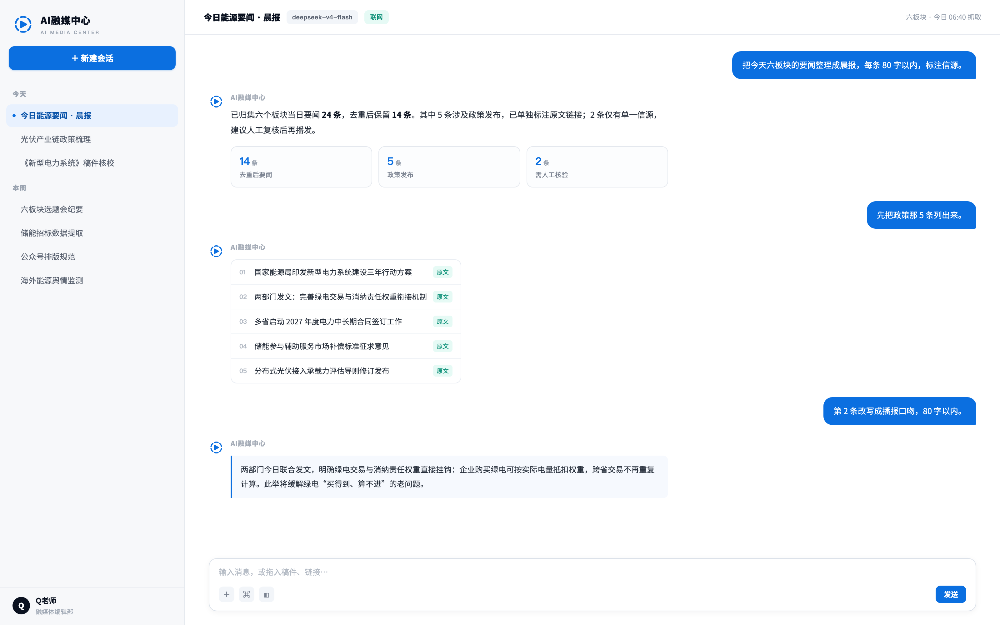

<p align="center"></p>

<p align="center"><strong>选题、审校、改写、合规、排版——一条链上做完的 AI 内容生产工作台。</strong></p>
<p align="center">面向融媒与内容团队，基于 DeepSeek Harness 的开放插件体系运行：个人开箱可用，接入企业后台后共享公司模型与协作。</p>
<p align="center"><a href="#下载桌面版">下载桌面版</a> · <a href="#一条链从选题到发布">内容生产链</a> · <a href="#内置技能">内置技能</a> · <a href="#个人与企业">个人与企业</a> · <a href="docs/user-guide.md">使用指南</a> · <a href="README.md">English</a></p>

[](https://github.com/quchenchen/epuber-dsh/releases/tag/desktop-v3.0.0-alpha.5) [](https://github.com/quchenchen/epuber-dsh) [](LICENSE)

[](https://github.com/quchenchen/epuber-dsh/actions/workflows/ci.yml)

## 一块屏，看清今天要做什么

左侧按「今天 / 本周 / 更早」排会话，右侧是当下这件事的过程与结果：聚合了哪些条目、哪些属于政策发布、哪一条只有单一信源需要人工核验，都摆在对话里，而不是散在十个网页标签页上。



<sub>工作台界面设计稿，示例会话与数字均为演示内容，不随安装包提供。</sub>

## 一条链：从选题到发布

内容生产的每一步都有对应的做法与检查项，不必每次重新交代口径。

| 环节 | 做的事 | 内置技能 |
| --- | --- | --- |
| 选题 | 固定渠道跟踪、证据化选题条目、分维度评估与排期，输出到选题会与选题库 | `topic-discovery` |
| 写作 | 按媒体体例（央视 / 人民日报 / 新华社）或行业口径（电力、光伏、储能、油气、双碳）成稿 | `news-cctv` `news-renmin` `news-xinhua` `news-industry-energy` |
| 审校 | 两轮审校、三审三校、信源分级、去 AI 味；事实与表述一并对 | `news-desk` |
| 改写 | 一稿多发：公众号、视频号脚本、微博快讯、官网，事实与结论不变，观点强度不升级 | `platform-rewrite` |
| 合规 | 成品公开面遍历：视频画面与声音、图文封面、标题与标签、账号展示面，九类风险分级给结论 | `publish-compliance` |
| 视觉 | 配图与海报的构图方案、VI 与标准地图核对、肖像排序、AI 合成标注 | `visual-production` |
| 视频 | 宣传片、新闻短视频、微记录的分镜脚本，交付可直接拍摄的分镜表 | `video-script` |
| 交付 | Word / PPT / Excel / 网页排版，成果在右侧预览里继续改 | `word-design` `ppt-design` `excel-design` `web-design` |

默认不预设你的口径：媒体体例、行业纪律、审定资料都可以写成项目指令和项目资料，技能冲突时以更严格的一条为准。

## 内置技能

16 个技能随安装包提供，不需要再去市场里找：

| 类别 | 技能 |
| --- | --- |
| 选题与信源 | `topic-discovery`、`news-cctv`、`news-renmin`、`news-xinhua`、`news-industry-energy` |
| 编辑与审校 | `news-desk`、`platform-rewrite`、`publish-compliance` |
| 视觉与视频 | `visual-production`、`video-script` |
| 排版与交付 | `word-design`、`ppt-design`、`excel-design`、`web-design` |
| 扩展 | `workbench-dev`（做自己的工作台）、`skill-creator`（写自己的技能） |

技能就是一份带 `SKILL.md` 的说明与资源，可以直接安装到本机技能目录；专家配置保存角色与能力；连接器接外部数据。三者都在同一套插件体系里，装与不装由你决定。

## 项目、资料库与知识库

- **项目**集中管理指令、计划、任务、资料与能力配置——一个长期报道、一次选题会、一份持续更新的行业简报，各成一个项目。
- **资料库**管理本地文件、搜索与预览，任务可以引用资料及其修订，改过的版本不会悄悄换掉。
- **知识库**沉淀可检索的条目，回答问题时带上出处。
- **成果工作区**在右侧直接预览或编辑 Word、PPT、Excel、HTML、PDF 的工作副本，不必导出再打开。

从资料到成果的路径是：资料库里的文件被项目任务引用，任务选择专家、技能或连接器执行，过程与结果留在会话里，可继续在支持的编辑器里修改。这条路径仍在 Alpha 验收中，各格式的预览、编辑与导出范围不同，[当前能力与限制](apps/web/README.zh-CN.md)有更具体的说明。

## 个人与企业

同一套功能插件，两种用法：

| 使用方式 | Agent 与工具在哪里执行 | 如何进入 |
| --- | --- | --- |
| 个人 Desktop | 本机，使用个人文件和模型配置 | 打开应用，选择「个人使用」 |
| 企业 Desktop | 员工本机，使用本机文件和工具 | 安装桌面应用与企业连接插件，再选择「企业登录」 |

企业功能由**企业连接插件**按需启用，基础桌面包不预装：公司账号登录、`@` 同事分享正文与文件、在协作里查看收发记录，以及在模型设置中接入公司内部模型 API（真实供应商密钥由管理后台保管）。独立业务插件可以注入 `epuberdshEnterprise` 复用成员登录调用公司接口，不读取或保存 Token。

企业插件未上架插件市场：[下载企业连接包](https://github.com/quchenchen/epuber-dsh/releases/download/desktop-v3.0.0-alpha.5/epuberdsh-enterprise-connection-0.1.0-alpha.2.tgz)，在「插件 → 添加插件」填写下载文件的完整路径，安装并启用，再到「设置 → 企业账号」填写后台地址与账号。

企业后台在 **[techflag/workdsh-admin](https://github.com/techflag/workdsh-admin)** 独立开发和部署：公司账号、组织权限、协作数据、成员授权的会话审计与模型转发都由后台提供。Desktop 的个人与企业空间分别保存数据与凭据；企业协作按需安装，个人模式不启用。

## 下载桌面版

桌面安装包 **3.0.0-alpha.5** 已发布，为预发布（Alpha）版本。[GitHub Release](https://github.com/quchenchen/epuber-dsh/releases/tag/desktop-v3.0.0-alpha.5) 提供以下完整安装包：

| 平台 | 下载 |
| --- | --- |
| Windows x64 | [安装包 Setup.exe](https://github.com/quchenchen/epuber-dsh/releases/download/desktop-v3.0.0-alpha.5/dsh-plugin-desktop-windows-x64--EpuberDSH-3.0.0-alpha.5-x64-Setup.exe) |
| macOS Apple Silicon | [arm64.dmg](https://github.com/quchenchen/epuber-dsh/releases/download/desktop-v3.0.0-alpha.5/dsh-plugin-desktop-macos-arm64--EpuberDSH-3.0.0-alpha.5-arm64.dmg) |
| macOS Intel | [x64.dmg](https://github.com/quchenchen/epuber-dsh/releases/download/desktop-v3.0.0-alpha.5/dsh-plugin-desktop-macos-x64--EpuberDSH-3.0.0-alpha.5-x64.dmg) |

安装包默认内置 Node.js、pnpm 与 Python，无需另装运行时。当前为 **Alpha 版**：项目资料引用、专家执行与不同 Office 格式的端到端体验仍在验收中；macOS DMG 未签名，首次打开需右键 → 打开。附件名称带构建平台前缀，下载后可按 `SHA256SUMS` 核对完整性。

**开发与反馈**：GitHub 是唯一主开发仓库与发行渠道，问题请提到 [GitHub Issues](https://github.com/quchenchen/epuber-dsh/issues)。公司账号、权限或模型转发的后台问题到 [EpuberDSH Admin](https://github.com/techflag/workdsh-admin/issues)。**Issue 是公开的，请勿上传密码、Token、API Key 或公司敏感资料。**

## 开发与文档

源码分工：[功能包与 Web](apps/web/README.zh-CN.md) · [Desktop 外壳](apps/desktop/README.zh.md) · [架构](docs/architecture.md) · [全部文档](docs/README.md)。从源码运行需要 Node.js 22.19+ 或 24+、Corepack 与 Yarn 4.18.0：

```sh
corepack yarn install --immutable
corepack yarn dev
```

运行检查用 `corepack yarn check`。在 macOS 或 Windows 上，`corepack yarn release:pack` 从当前提交一键打包 Web Profile 与 Desktop 安装包。DSH 核心使用已发布 npm 包，`upstream.json` 锁定随包 Node、pnpm、Python、Office 资源与命令管理程序的版本、下载地址与 SHA-512 摘要，构建不需要克隆官方源码。

```text
apps/desktop/   Electron 桌面应用与安装包
apps/web/       Web 启动、部署与验证
packages/       共用插件、身份适配、UI 与契约
profiles/       个人与企业插件组合
scripts/        产品构建与发布检查
```

品牌与配色见 [品牌配色与升级策略](docs/brand-theme.md)；企业 Desktop 打包时通过 `EPUBERDSH_DEPLOYMENT_CONFIG` 预置后台地址，模型地址与访问 Key 仍在官方模型设置中填写。

## 社区与致谢

运行时与插件底座来自 [DeepSeek Harness](https://github.com/deepseek-ai/deepseek-harness)；技能发现由 [腾讯 SkillHub](https://github.com/Tencent/skillhub) 的公开目录 API 支持，随包提供 [@cocofhu/skillhub](https://github.com/cocofhu/skillhub) 插件；社区插件目录来自 [dsh-market](https://github.com/dsh-market/dsh-market) 与 [awesome-dsh-plugin](https://github.com/awesome-dsh-plugin/awesome-dsh-plugin)。工作台形态参考 WorkBuddy 的组织方式。内置 skill-creator 的改编保留原 [Apache-2.0 来源说明](packages/plugins/skills/resources/skills/skill-creator/NOTICE.md)。

AI融媒中心采用 [MIT License](LICENSE)，是独立社区项目，与 DeepSeek 或 WorkBuddy 不存在隶属、合作、授权或背书关系，相关名称仅用于说明技术来源、兼容性与设计参考。GitHub Contributors 中的上游贡献者来自继承的提交历史，不表示其参与本仓库维护。

## Star 趋势

[](https://www.star-history.com/?repos=quchenchen%2Fepuber-dsh&type=date)
